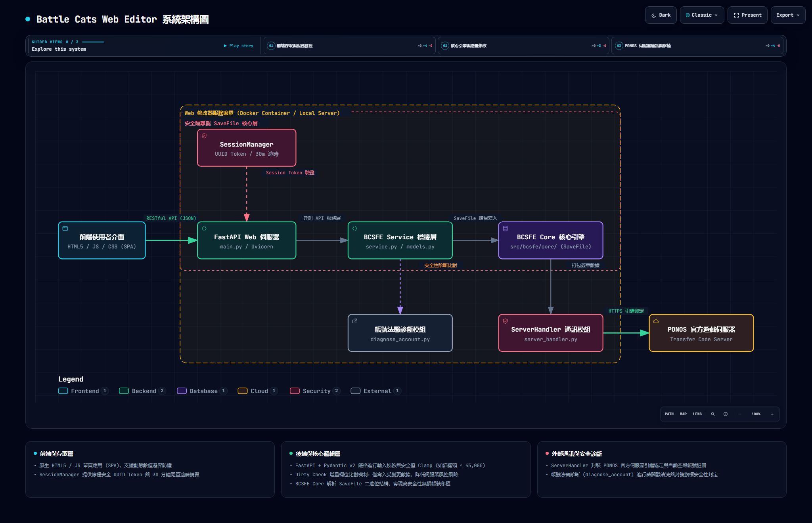

<div align="center">

# Battle Cats Web Editor

**免安裝、免越獄的《貓咪大戰爭》網頁版存檔修改與備份工具**

[](./LICENSE)
[](https://www.python.org/)
[](https://fastapi.tiangolo.com/)

</div>

---

## 專案簡介

Battle Cats Web Editor 是專為《貓咪大戰爭》玩家設計的網頁版存檔修改工具。不需要在手機上安裝複雜修改器，也不需要手機越獄或取得 Root 權限，只要打開瀏覽器、輸入遊戲內的引繼碼，就能直接調整資源、解鎖貓咪與通關進度。修改完成後自動生成全新引繼碼，一鍵引繼回手機即可繼續遊玩。

## 解決痛點

- 免越獄免 Root：告別傳統安裝未知修改版 APK 或修改系統檔案的繁瑣流程，純網頁介面即可完成操作。
- 防封號安全保護：內建數值安全限制，罐頭、經驗值與票券皆有合理上限防護，且僅上傳實際修改的項目，降低官方伺服器異常偵測風險。
- 複製帳號與分身：提供一鍵複製帳號功能，可將存檔進度完整複製到全新帳號，方便體驗不同陣容或建立分身。
- 歷史備份防手殘：後台自動記錄每次修改歷史，改錯或想重來隨時可一鍵還原，不怕存檔損壞。

## 核心功能

### 1. 資源與抽獎券修改
- 核心物資：自由修改貓罐頭、XP 經驗值、NP 本能點數、統率力首領旗。
- 扭蛋券與碎片：支援銀券、金券、白金券、傳說券、白金碎片與活動幸運券。
- 養成材料與道具：戰鬥道具、喵力達、貓眼石、貓薄荷、城堡建築素材、本能玉、迷宮獎牌等全道具調整。

### 2. 貓咪角色全方位養成
- 一鍵角色全解鎖：支援一鍵取得全系列貓咪（EX 到傳說稀有），等級上限全滿（含加值）。
- 進化形態與本能：支援一鍵解鎖全角色三階與四階進化形態，並將角色本能點至滿等。
- 指定貓咪解鎖：支援輸入特定貓咪編號，精準解鎖自己想要的個別角色。
- 加碼多多探險隊：一鍵提升探險隊至 130 級滿經驗，並將隊員全數升級為 10 位傳說級隊員。

### 3. 主線章節與關卡進度
- 一鍵關卡全破：支援世界篇 (1-3 章)、未來篇 (1-3 章)、宇宙篇 (1-3 章)、魔界篇與新手教學一鍵通關。
- 最高品質金寶：一鍵刷滿世界篇、未來篇與宇宙篇全章節最高等級金寶。
- 全獎章成就：一鍵解鎖遊戲內全部成就獎章。

### 4. 複製帳號與存檔管理
- 複製帳號：支援將目前帳號的全部進度複製並轉移到全新空殼帳號，保留進度的同時建立完全獨立的帳號。
- 歷史備份與還原：後台自動留存每次編輯的歷史版本，支援搜尋詢問碼隨時還原至新帳號。
- 帳號安全健康檢查：內建存檔診斷功能，自動檢查物資是否過量、時間設定是否異常，提前預警封號風險。

### 5. 多地區與多版本相容
- 完整支援台版 (TW)、日版 (JP)、國際版 (EN) 與韓版 (KR)，並可自訂相應遊戲版本號。

## 運作原理

本工具透過後端伺服器與官方引繼協定進行通訊。使用者登入引繼碼後，伺服器於記憶體中安全解析存檔資料，經前端網頁介面調整數值後重新簽章並上傳回官方伺服器，最後回傳一組全新的引繼碼供遊戲端還原。



## 快速開始

### 存檔修改四步驟

1. 取得遊戲引繼碼：開啟《貓咪大戰爭》，點擊「選單」>「轉移引繼資料」>「上傳存檔到伺服器」，記下轉移碼與認證碼。
2. 網頁登入存檔：在修改器網頁輸入轉移碼與認證碼，選擇你的遊戲地區（如 TW 台版）與版本。
3. 自由調整內容：於網頁儀表板修改所需的罐頭、票券、角色解鎖或通關進度。
4. 儲存引繼回手機：點擊「儲存並上傳至伺服器」，記下網頁產生的新引繼碼，回到遊戲點選「恢復引繼資料」即可。

## 本地開發與部署

### 環境需求

- Python 3.9+
- Docker（可選，用於容器化部署）

### 本地執行

1. 下載專案：
   ```bash
   git clone https://github.com/thomas950321/BattleCats-Web-Editor.git
   cd BattleCats-Web-Editor
   ```

2. 安裝依賴：
   ```bash
   pip install -r requirements.txt
   ```

3. 啟動服務：
   ```bash
   python bcsfe_web/main.py
   ```

4. 開啟瀏覽器訪問 `http://localhost:8000`。

### Docker 部署

```bash
docker build -t battlecats-web-editor .
docker run -d -p 8000:7860 battlecats-web-editor
```

## 專案結構

```
BCSFE-Python/
├── bcsfe_web/           # FastAPI 網頁服務層 (API 路由、模型、業務服務)
│   ├── static/          # 前端單頁應用 (HTML, CSS, JS)
│   ├── main.py          # Web 服務入口點
│   ├── models.py        # 資料模型定義
│   ├── scanner.py       # 存檔安全性診斷模組
│   ├── database.py      # 歷史存檔資料庫
│   └── service.py       # 核心轉接服務與業務邏輯
├── src/bcsfe/core/      # BCSFE 存檔解析與伺服器通訊引擎
├── diagnose_account.py  # 帳號安全性分析腳本
├── Dockerfile           # Docker 容器構建檔
└── pyproject.toml       # Python 專案配置
```

## 免責聲明

- 本專案僅供學術交流、技術研究與個人存檔備份用途。
- 請遵守合理使用原則，過度修改數值可能導致帳號遭官方封鎖，使用者需自行承擔相關風險。
- 請支持正版遊戲《貓咪大戰爭》。

## 致謝

- 核心邏輯引擎：[fieryhenry/BCSFE-Python](https://github.com/fieryhenry/BCSFE-Python)
- 網頁框架：[FastAPI](https://fastapi.tiangolo.com/)

## 授權條款

本專案採用 [GNU GPLv3](./LICENSE) 開源授權協定。
